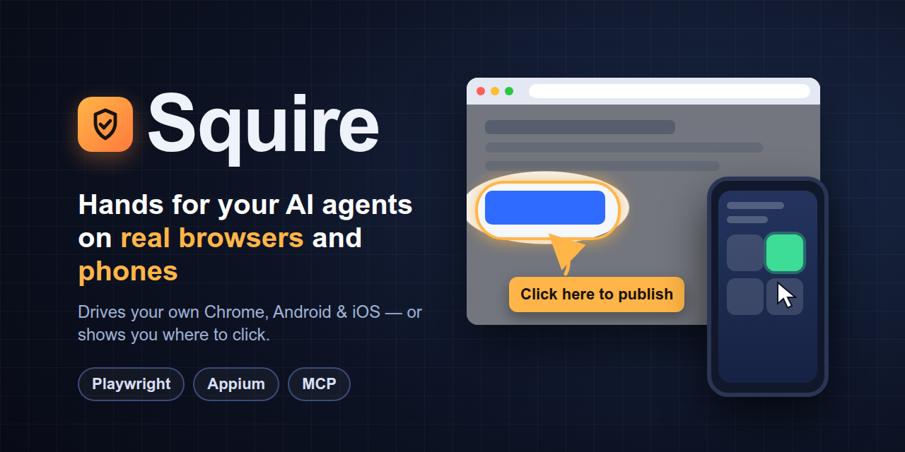

<p align="center">
  
</p>

# Squire — hands for AI agents on real browsers and phones (MCP)

[](https://opensource.org/licenses/Apache-2.0)
[](https://www.npmjs.com/package/@sniffski/squire)

**Squire** is a Model Context Protocol (MCP) server that gives AI agents hands on real browsers and phones. It drives web pages through Playwright the way a person would: logging in, filling forms, clicking through flows and reading what comes back. It can attach to the Chrome you already have open, with your logins, instead of a throwaway browser. It can also walk _you_ through a site with an on-screen guided tour. Android and iOS apps are driven through Appium.

> Squire grew out of [appium-mcp](https://github.com/appium/appium-mcp) and still ships its Appium mobile tools. It is an independent project, **not affiliated with the Appium project**.

## What makes it different

- **`run_script` — drive a page like a human in one call.** A sequence of steps (fill → click → wait → verify) that **survives navigations** (a form submit no longer aborts the rest), **reveals hidden/shadow-DOM elements** when a plain click can't reach them, and **stops-and-resumes** on failure instead of blindly barreling on.
- **Presenter — show a person how, on their own screen.** Say "show me how to…" and `playwright_present` walks them through the site: the page dims, a spotlight glides to each element, an arrow bobs toward it, and a caption explains the step. A compact caption sits right next to the highlighted element. In **guided** mode (default) the person does each step and the tour follows them across clicks, inputs and page loads; **Next** does the step for them if they haven't, and **Back** undoes a page change. **Demo** mode is hands-free: each step stays up for 5 seconds with a countdown bar, then Squire does it with a visible cursor. It never types passwords or card numbers. Tours always run in a browser the person can see: a headless session is reopened headed first, on the same page with the same cookies and localStorage.
- **Real multi-tab.** Stable tab ids let you drive several background tabs **concurrently** without them clobbering each other — and the orchestrator plans parallel work when a task fans out.
- **Attaches to your real Chrome** over CDP, so cookies, logins, redirects and captchas behave exactly as they do for you — with guards so the AI never hijacks the tab you're using.
- **Vision grounding** for canvas/WebGL/custom UIs where DOM selectors fail: OCR text labels plus an optional ONNX icon detector.
- **Self-cleaning**: closes browsers it no longer needs and drops sessions when the attached browser goes away.

## Install

### As a Claude Code plugin (recommended — one step)

```
/plugin marketplace add ihubanov/squire
/plugin install squire@squire
```

This installs the web-driving, captcha-dial, presenting and android-driving skills, the `browser-driver` and `presenter` subagents, the cleanup hook, **and** the MCP server (via `npx @sniffski/squire`). Restart the session afterwards.

### As a plain MCP server

```bash
npx @sniffski/squire          # stdio MCP server
```

Point your MCP client at that command. To attach to a running Chrome, launch Chrome with `--remote-debugging-port=9222`, or turn on "Allow remote debugging for this browser instance" at `chrome://inspect/#remote-debugging`, and set `APPIUM_MCP_CDP_ENDPOINT=http://localhost:9222`. The toggle has no `/json` discovery, so Squire reads the browser's WebSocket URL from `DevToolsActivePort` in the Chrome, Chromium, Brave or Edge profile directory (or `APPIUM_MCP_CHROME_PROFILE_DIR`); if it finds none, pass the `ws://127.0.0.1:<port>/devtools/browser/<id>` form from that file as `cdpEndpoint`, and Chrome asks you to click Allow when Squire connects. Squire holds that one connection and every session shares it, so you are asked once; it closes the connection after 10 minutes with no session (`APPIUM_MCP_CDP_IDLE_MS`). With several Chrome profiles open, tabs are listed by profile and new tabs open in the profile of the tab Squire is working in. One backend can serve several browsers: pass `cdpEndpoint` (`http://host:port`, `host:port` or a `ws://` URL) to `create_session` to attach that session to its own Chrome, overriding the env var. Each browser gets its own shared connection. If that attach fails the call fails instead of opening a separate browser, and a refusal because the user has taken control (403, or herdr's 423 with reason `unheld`) is reported as "Control revoked" and never retried; a 423 with reason `unauthorized` or `unreachable` is reported as a gate configuration problem instead. If an attached browser's connection is cut mid-session, the session's next tool calls also fail with "Control revoked" rather than "no session", until a new session is created.

## Quick start

With the plugin installed, just ask:

- "Open example.com and tell me what the pricing page says."
- "Log in to my dashboard and download last month's invoice."
- "Show me how to change my notification settings on this site." This starts a guided tour on your screen.

To have Squire work in your own Chrome, turn on remote debugging at `chrome://inspect/#remote-debugging`, set `APPIUM_MCP_CDP_ENDPOINT=http://localhost:9222`, and click Allow when Chrome asks.

## Configuration (env)

| Var                                                    | Purpose                                                                                                                                                                                                                                                                                                                                                |
| ------------------------------------------------------ | ------------------------------------------------------------------------------------------------------------------------------------------------------------------------------------------------------------------------------------------------------------------------------------------------------------------------------------------------------ |
| `APPIUM_MCP_CDP_ENDPOINT`                              | Attach to a running Chrome (e.g. `http://localhost:9222`). Unset → launches its own detached browser.                                                                                                                                                                                                                                                  |
| `APPIUM_MCP_CDP_ALLOWED_HOSTS`                         | Hosts a caller may name in `create_session`'s `cdpEndpoint` besides loopback (comma-separated `host` or `host:port`, `*` = any). Default: loopback only.                                                                                                                                                                                               |
| `APPIUM_MCP_CDP_IDLE_MS`                               | How long to keep the connection to the user's Chrome after the last session ends (default 600000 = 10 min). Each new connection is a new Allow prompt.                                                                                                                                                                                                 |
| `APPIUM_MCP_CDP_KEEP_CONNECTION`                       | `0` → disconnect from the user's Chrome as soon as the last session ends.                                                                                                                                                                                                                                                                              |
| `APPIUM_MCP_CDP_TRACE`                                 | File to log CDP method names to, for debugging an attach.                                                                                                                                                                                                                                                                                              |
| `APPIUM_MCP_CHROME_PROFILE_DIR`                        | Chrome profile directory to read `DevToolsActivePort` from, when it isn't the default Chrome/Chromium one.                                                                                                                                                                                                                                             |
| `APPIUM_MCP_RESPECT_USER_FOCUS`                        | `true` to stop the AI acting on the tab the user is looking at (for shared screens). Default off, so you and the AI can work in the same tab.                                                                                                                                                                                                          |
| `APPIUM_MCP_VISION_MODEL` / `APPIUM_MCP_VISION_PYTHON` | Enable the ONNX icon detector (path to the `.onnx` + a Python with `onnxruntime`). OCR text grounding works without them.                                                                                                                                                                                                                              |
| `APPIUM_MCP_CAPTCHA`                                   | `1` registers the captcha tools (off by default while they are new): `playwright_captcha_solve` (dispatching entry point: reCAPTCHA or rotation dial), `playwright_captcha_recaptcha` (Google reCAPTCHA v2/v3) and `playwright_captcha_turnstile` (Cloudflare Turnstile).                                                                                                                                                                                                                                                     |
| `APPIUM_MCP_CAPTCHA_VLM_URL` / `..._MODEL` / `..._KEY` | Vision endpoint that classifies reCAPTCHA image grids (OpenAI-compatible chat completions). Unset → the claude-local hunch config is used when present; no endpoint → grids are returned as `needs_answer` for the caller to solve. `APPIUM_MCP_CAPTCHA_VLM=0` disables it.                                                                                                                                                |
| `APPIUM_MCP_WATCH`                                     | `1` shows ambient cues while Squire drives a visible browser, at real speed: a cursor gliding to each target, a highlight box, a ripple on click, a caption naming the action and a toast on navigation. Passive — nothing waits for the person. Also cues captcha drags, so the turn is seen rather than jumped. Adds well under a second per action. |

## Credits and license

Apache-2.0. Squire started as a fork of [appium/appium-mcp](https://github.com/appium/appium-mcp) by the Appium contributors; the inherited code keeps its original Apache-2.0 license and copyright. Squire is an independent project and is not affiliated with or endorsed by the Appium project.
